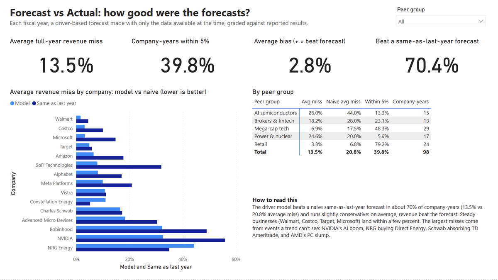
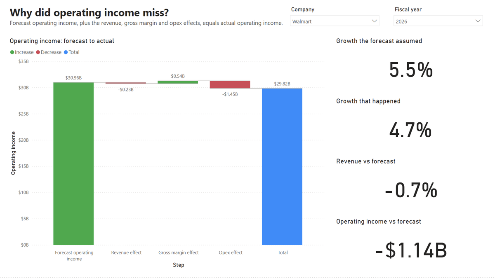
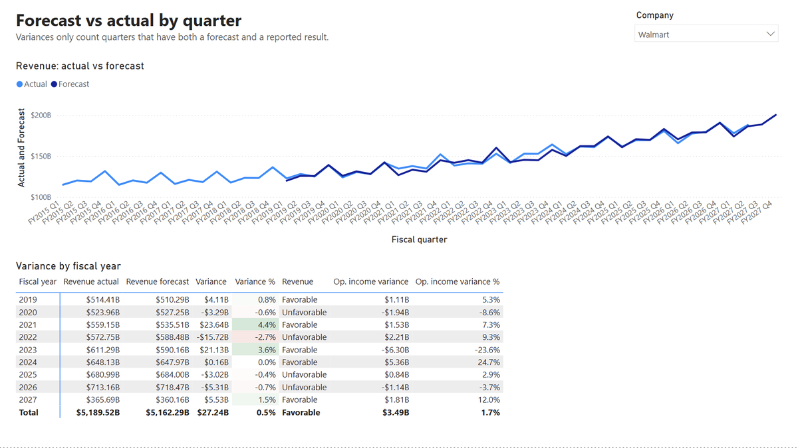
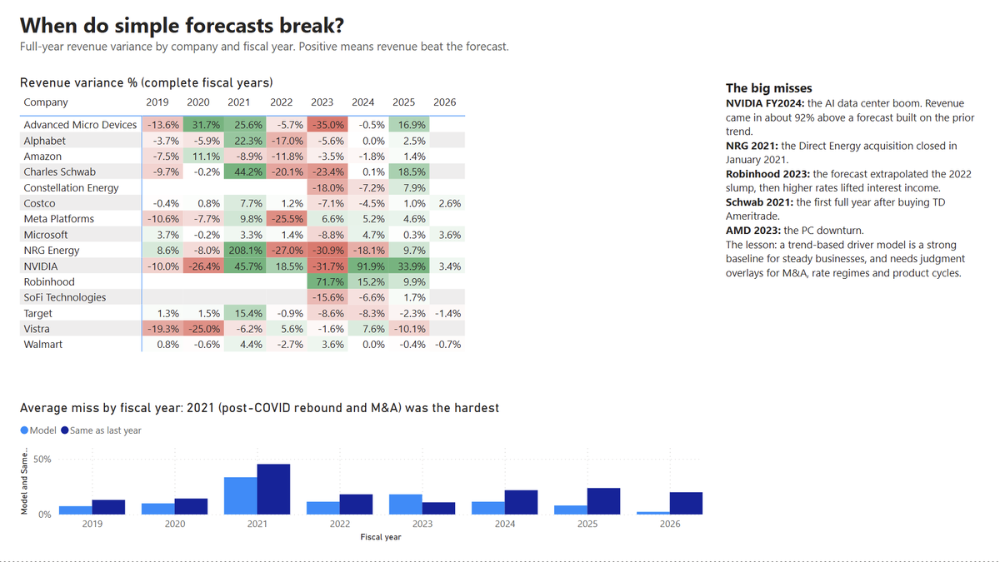

# Power BI: Forecast vs Actual. Grading driver-based forecasts on 15 public companies

**If an FP&A analyst had forecast these companies at the start of each year, using only what was known then, how close would they have been, and what explains the misses?**

This project builds that forecast for 15 public companies across five peer groups, for every fiscal year since 2019. It compares each forecast to what the companies actually reported and splits every operating income miss into revenue, gross margin and operating expense effects. The data comes straight from SEC filings, and the analysis is a Power BI report.

## Why it's built this way

Public companies don't publish their internal budgets, so this project creates its own. At the start of each fiscal year it "stands in the past" and forecasts the next four quarters using only actuals reported up to that point. That rules out hindsight and makes the accuracy numbers honest.

The forecast is driver-based, the way a planning model would be:

| Driver | How it's set at the forecast date |
|---|---|
| Revenue growth | Blend of last year's growth and the 3-year growth rate, applied to the same quarter last year so seasonality carries through |
| Gross margin | Trailing 4 quarters |
| Operating expenses % of revenue | Trailing 4 quarters |
| Net margin | Trailing 4 quarters |

Because forecast operating income = revenue × (gross margin − opex %), every variance splits exactly into:
- a **revenue effect**: selling more or less than planned
- a **gross margin effect**: pricing and cost of goods
- an **opex effect**: spending discipline

The pieces always add up to the total miss. The pipeline checks this for all 98 complete company-years.

## Companies

| Peer group | Companies |
|---|---|
| Retail | Walmart, Costco, Target |
| Mega-cap tech | Amazon, Alphabet, Meta, Microsoft |
| AI semiconductors | NVIDIA, AMD |
| Power & nuclear | Constellation Energy, Vistra, NRG |
| Brokers & fintech | Charles Schwab, Robinhood, SoFi |

## Early findings from the backtest

- **Stable businesses forecast well:**
  - Walmart's median full-year revenue miss is 0.8%.
  - Costco and Target are at 1.9%, Microsoft at 3.4%.
- **Overall:** the median miss across all company-years is 7.4% (the average is 13.5%, pulled up by a few huge misses), and 40% land within 5%.
- **Better than the naive baseline:** the driver model beats a same-as-last-year forecast in 70% of company-years. Its average miss is 13.5%, against 20.8% for the baseline.
- **Slightly conservative:** on average, actual revenue beat the forecast by 2.8%. That's typical for trend models during a decade of strong growth.
- **Hardest year:** FY2021 (the post-COVID rebound and several acquisitions), with an average miss of 33.5%.
- **The biggest misses are business events, not model noise:**
  - NVIDIA FY2024 (the AI boom): actual revenue came in 92% above forecast.
  - NRG 2021: the Direct Energy acquisition.
  - Schwab 2021: the TD Ameritrade integration.
  - AMD 2023: the PC downturn.
- **The FP&A lesson:** a trend-based forecast is a strong baseline for steady businesses. It needs judgment overlays for M&A, regime shifts and product cycles, and the report shows where those overlays would have mattered most.

## The report

The report is a Power BI project in [`powerbi/ForecastVsActual.pbip`](powerbi/). It's stored as text (a TMDL data model and PBIR report pages), so every measure and visual can be read and reviewed on GitHub. [`powerbi/generate_pbip.py`](powerbi/generate_pbip.py) regenerates it from code.

- **Building it:** [docs/powerbi-build-guide.md](docs/powerbi-build-guide.md) covers opening the project, or rebuilding it step by step, with how each step maps to the PL-300 exam.
- **Explaining it:** [docs/model-walkthrough.md](docs/model-walkthrough.md) explains the modeling and DAX choices in plain English.

It has six pages:

1. **Summary:** forecast accuracy across companies and peer groups.
2. **Forecast vs actual:** quarterly lines and a variance matrix with favorable and unfavorable flags.
3. **Variance bridge:** a waterfall from forecast to actual operating income.
4. **Accuracy over time:** a heatmap of company × year, with notes on the big misses.
5. **Peer benchmarking:** growth vs margin, and margin trends.
6. **Scenario planner:** growth and margin sliders that flex the current-year outlook.

**Summary**


**Variance bridge: Walmart FY2026**


**Forecast vs actual: Walmart**


**Accuracy over time**


## Data pipeline

```bash
cp .env.example .env        # SEC asks for a contact: "Your Name you@example.com"
pip install -r requirements.txt
./run_pipeline.sh
```

| Step | Script | Output |
|---|---|---|
| Pull quarterly actuals from SEC XBRL company facts | `pipeline/fetch_actuals.py` | `fact_actuals.csv`, `dim_company.csv` |
| Build point-in-time forecasts and drivers | `pipeline/build_forecasts.py` | `fact_forecast.csv`, `fact_drivers.csv`, `dim_period.csv` |
| Check totals against annual reports, check the bridge ties out, write reference answers | `pipeline/validate.py` | `check_values.csv` |

**Data notes:**
- **Fiscal calendars.** Each company stays on its own fiscal calendar, built from the period dates in its filings. Fiscal years are named by the calendar year they end in, so Walmart's year ending January 2026 is FY2026. (Target calls that year fiscal 2025.)
- **Fourth quarters.** Q4 is the full fiscal year minus Q1 to Q3, because companies rarely report Q4 on its own.
- **Validation.** Full-year revenue for all 15 companies matches their annual reports exactly.
- **Gross margin coverage.** Power, broker and fintech companies have no meaningful cost-of-revenue line, so they're modeled on operating margin. Target is too, because it tagged cost of sales under a company-specific name for fiscal 2020 to 2021.
- **Operating income for brokers.** Schwab, Robinhood and SoFi report pre-tax income instead of operating income; the column `OperatingIncomeIsPreTax` flags it.

## Tools

Python (pandas) for the pipeline, SEC EDGAR XBRL as the data source, and Power BI (Power Query, DAX, calculation groups, field and what-if parameters, row-level security) for the report.

Companion project: [Market Desk](https://github.com/rilozano2/market-desk), a live dashboard tracking the same kinds of companies day to day.
